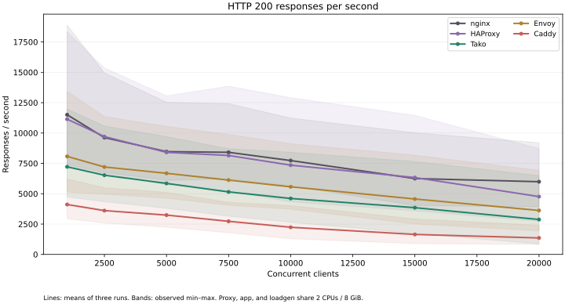
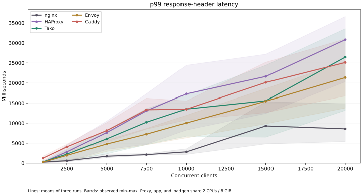
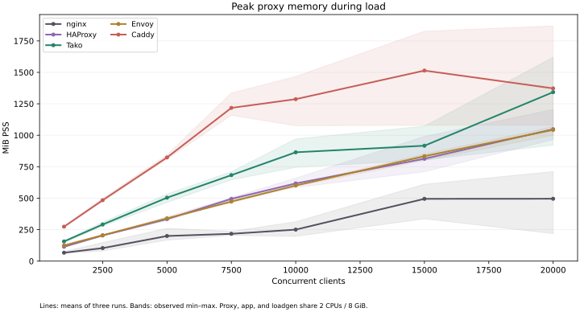
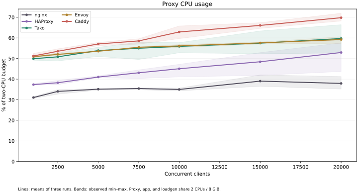
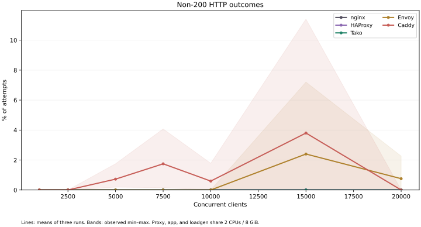
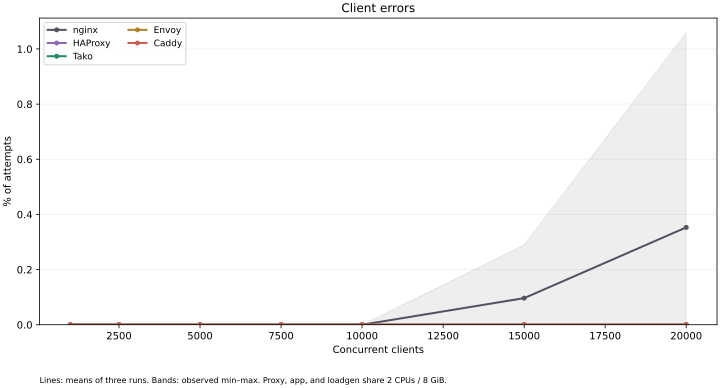
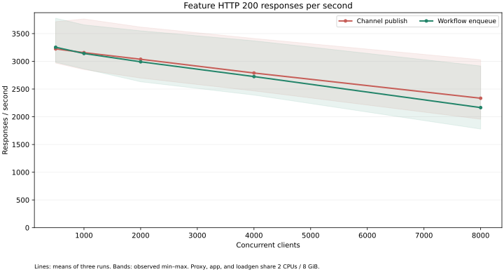
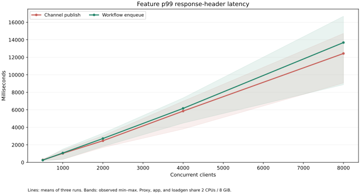
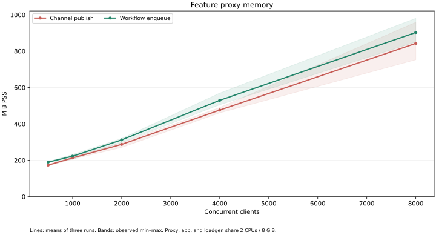
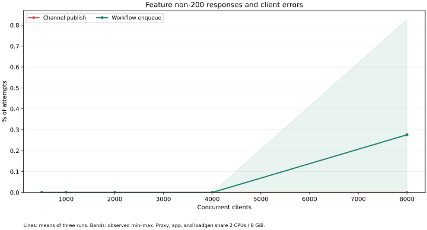

# Complete five-proxy benchmark — 2026-10-27

This replaces the current public benchmark with a complete rerun of Tako, nginx, HAProxy, Envoy, and Caddy, plus Tako channel and workflow workloads. All charts and resource figures below come from this suite; historical VM and targeted buffer measurements remain separate archives.

All **135 measurement cases** completed: 105 HTTP cases and 30 feature cases. Every point has three repetitions. Tako averaged **5,850 complete 200 RPS at c5000** and **2,877 at c20000**. Across its 21 HTTP cases, it recorded **0 non-200 responses and 0 client errors**.

Tako’s mean peak proxy PSS at c20000 was **1,342.8 MiB**, measured during those same throughput runs. Compare memory with successful outcomes; rejecting or timing out requests is not equivalent served capacity.

Tako was faster than Caddy at every tested concurrency, but nginx, HAProxy and Envoy had higher successful throughput. Tako and HAProxy were clean across all their HTTP cases. The other proxies had non-200 responses or client errors in at least one case. The remaining Tako memory footprint is substantial; this report does not call that problem solved.

## Measurement quality

All 135 runs are included; 122 completed without HTTP or client errors. Two nginx c15000 runs supplied 24 and 23 resource samples rather than the planned minimum 25 (covering 29.04 s and 28.17 s). Their memory peaks may be undersampled. One Tako c15000 load-generator CPU counter reset when the process exited: that aggregate is **unavailable**, not a negative CPU value or an average of only the other two runs. Proxy/app CPU, total cgroup CPU, requests and memory are independently checked. See `qualityFlags` in analysis.json and the unchanged raw samples.

## Setup and build identity

- Tako server and JavaScript SDK source: `1093899fd6b09d6227e5b7b585ee8bfeb4b5c028`.
- Free standard Ubuntu 24.04 GitHub runners; a shared Ubuntu 26.04 container image.
- Two assigned logical CPUs, a 2-CPU quota, 8 GiB memory limit, and no swap. Client, proxy, app, and sampler share the budget.
- Each HTTP repetition runs all five proxies and all seven concurrency levels on one host. Proxy order rotates between repetitions and reverses at alternating levels. Feature repetitions run on separate hosts.
- Original HTTP/1.1-over-TLS workload: one Go plaintext app, one RSA certificate per repetition, Host/SNI `bench.test`, 16 loopback source IPs, a 10-second warmup, 30-second measurement, 60-second request timeout, and 10-second cooldown.
- Backend apps and workflow workers use matching 65,535-file descriptor limits, checked in every sample. Tako’s production app default is 4,096; this benchmark configures a higher app limit without changing the server binary.
- Fresh processes and app state per case. Same original proxy configurations, with workers fixed at two and a fresh upstream port per case to avoid previous runs’ TIME_WAIT sockets consuming its port budget.
- RPS uses actual elapsed time including request drain. Latency ends at response headers; incomplete response bodies count only as client errors. Error requests do not contribute latency samples.
- One-second process/cgroup sampling. PSS apportions shared pages. nginx includes master and workers. App/workflow workers and loadgen are separate. Kernel socket memory is excluded.
- Values are means of per-run metrics, including means of each run’s p99 and peak PSS. They are not pooled latency percentiles. Figure bands show the observed min–max, not confidence intervals.
- New hardware and software establish a fresh baseline. Differences from the old exe.dev VM cannot be attributed solely to the buffer optimization.

| Software | Recorded version |
| --- | --- |
| nginx | nginx version: nginx/1.28.3 (Ubuntu) |
| HAProxy | HAProxy version 3.2.25-0ubuntu0.26.04.1 2026/09/24 - https://haproxy.org/ |
| Envoy | envoy  version: f1dd21b16c244bda00edfb5ffce577e12d0d2ec2/1.38.0/Clean/RELEASE/BoringSSL |
| Tako | tako-server 0.0.0 |
| Caddy | v2.11.7 h1:yj0Y4fYZGPkSvibBJ1sTWE33xC0fxztVyXEW5iIdUT4= |
| bun | 1.4.4 |
| openssl | OpenSSL 3.5.5 27 Jan 2026 (Library: OpenSSL 3.5.5 27 Jan 2026) |

| Group | Repetition | CPU | Kernel |
| --- | ---: | --- | --- |
| http | 1 | AMD EPYC 9V45 96-Core Processor | 6.17.0-1022-azure |
| http | 2 | AMD EPYC 7763 64-Core Processor | 6.17.0-1022-azure |
| http | 3 | AMD EPYC 7763 64-Core Processor | 6.17.0-1022-azure |
| features | 1 | AMD EPYC 7763 64-Core Processor | 6.17.0-1022-azure |
| features | 2 | AMD EPYC 9V74 80-Core Processor | 6.17.0-1022-azure |
| features | 3 | AMD EPYC 7763 64-Core Processor | 6.17.0-1022-azure |

Runtime image identity: `sha256:af308fec67ab9b61dd6053db786e2bae7b40bb15b2780a0dee39c2739a9753ee`. Each group’s metadata includes package versions and binary hashes; `build.txt` records the actual performance checkout. See [provenance.json](provenance.json) for workflow runs and artifacts.

## HTTPS results

| Proxy | Concurrency | 200 RPS | RPS range | p50 ms | p95 ms | p99 ms | Non-200 % | Client-error % |
| --- | ---: | ---: | --- | ---: | ---: | ---: | ---: | ---: |
| nginx | 1,000 | 11,504 | 7,400–18,887 | 82.5 | 183.0 | 250.8 | 0.000 | 0.000 |
| HAProxy | 1,000 | 11,140 | 7,249–18,339 | 96.1 | 157.7 | 209.6 | 0.000 | 0.000 |
| Tako | 1,000 | 7,216 | 4,735–11,977 | 159.1 | 265.5 | 333.4 | 0.000 | 0.000 |
| Envoy | 1,000 | 8,074 | 5,139–13,435 | 141.3 | 199.2 | 241.9 | 0.000 | 0.000 |
| Caddy | 1,000 | 4,111 | 2,937–6,213 | 269.9 | 368.8 | 1,236.5 | 0.000 | 0.000 |
| nginx | 2,500 | 9,623 | 6,746–14,957 | 269.8 | 454.7 | 602.6 | 0.000 | 0.000 |
| HAProxy | 2,500 | 9,706 | 6,640–15,357 | 247.9 | 422.3 | 2,819.3 | 0.000 | 0.000 |
| Tako | 2,500 | 6,524 | 4,340–10,578 | 409.2 | 845.0 | 2,251.8 | 0.000 | 0.000 |
| Envoy | 2,500 | 7,202 | 4,965–11,360 | 361.0 | 510.2 | 1,945.2 | 0.000 | 0.000 |
| Caddy | 2,500 | 3,609 | 2,584–5,493 | 712.7 | 1,015.7 | 4,070.4 | 0.000 | 0.000 |
| nginx | 5,000 | 8,467 | 6,096–12,534 | 596.5 | 921.9 | 1,736.6 | 0.000 | 0.000 |
| HAProxy | 5,000 | 8,406 | 5,752–13,059 | 489.1 | 864.4 | 7,648.5 | 0.000 | 0.000 |
| Tako | 5,000 | 5,850 | 3,798–9,694 | 816.4 | 2,189.0 | 6,074.0 | 0.000 | 0.000 |
| Envoy | 5,000 | 6,682 | 4,626–10,545 | 721.1 | 1,011.3 | 4,784.1 | 0.000 | 0.000 |
| Caddy | 5,000 | 3,240 | 2,236–5,115 | 1,424.5 | 6,080.5 | 8,148.0 | 0.724 | 0.000 |
| nginx | 7,500 | 8,411 | 6,218–12,419 | 903.1 | 1,344.3 | 2,124.3 | 0.000 | 0.000 |
| HAProxy | 7,500 | 8,150 | 5,202–13,857 | 596.2 | 2,427.4 | 13,074.0 | 0.000 | 0.000 |
| Tako | 7,500 | 5,149 | 3,152–8,708 | 1,246.4 | 6,728.5 | 10,224.6 | 0.000 | 0.000 |
| Envoy | 7,500 | 6,122 | 4,054–9,883 | 1,117.3 | 5,609.3 | 7,241.5 | 0.000 | 0.000 |
| Caddy | 7,500 | 2,727 | 1,786–4,286 | 2,091.7 | 10,875.1 | 13,329.0 | 1.747 | 0.000 |
| nginx | 10,000 | 7,732 | 5,652–11,231 | 1,283.9 | 1,897.1 | 2,831.6 | 0.000 | 0.000 |
| HAProxy | 10,000 | 7,351 | 4,329–12,909 | 873.6 | 6,323.0 | 17,288.4 | 0.000 | 0.000 |
| Tako | 10,000 | 4,610 | 2,642–8,414 | 1,767.7 | 10,875.6 | 13,500.2 | 0.000 | 0.000 |
| Envoy | 10,000 | 5,570 | 3,727–9,123 | 1,481.0 | 7,886.5 | 10,037.6 | 0.000 | 0.000 |
| Caddy | 10,000 | 2,238 | 1,291–4,019 | 4,907.9 | 12,118.3 | 13,468.2 | 0.594 | 0.000 |
| nginx | 15,000 | 6,250 | 4,014–10,019 | 2,152.3 | 6,855.2 | 9,293.5 | 0.000 | 0.096 |
| HAProxy | 15,000 | 6,331 | 3,595–11,451 | 1,655.8 | 11,316.2 | 21,640.8 | 0.000 | 0.000 |
| Tako | 15,000 | 3,851 | 1,723–7,652 | 3,813.4 | 13,541.6 | 15,565.0 | 0.000 | 0.000 |
| Envoy | 15,000 | 4,564 | 2,508–8,174 | 2,280.3 | 14,760.4 | 15,462.9 | 2.400 | 0.000 |
| Caddy | 15,000 | 1,646 | 889–2,924 | 7,223.1 | 19,006.9 | 20,139.3 | 3.802 | 0.000 |
| nginx | 20,000 | 5,989 | 3,920–9,201 | 3,182.4 | 6,761.8 | 8,571.9 | 0.000 | 0.353 |
| HAProxy | 20,000 | 4,764 | 2,729–8,712 | 2,522.7 | 20,007.2 | 30,819.6 | 0.000 | 0.000 |
| Tako | 20,000 | 2,877 | 852–6,490 | 12,450.2 | 24,439.7 | 26,453.5 | 0.000 | 0.000 |
| Envoy | 20,000 | 3,621 | 1,938–6,915 | 3,170.7 | 20,581.3 | 21,357.0 | 0.754 | 0.000 |
| Caddy | 20,000 | 1,359 | 828–2,397 | 15,775.0 | 23,747.9 | 25,118.4 | 0.000 | 0.000 |

## Memory and CPU from the same runs

| Proxy | Concurrency | Peak PSS MiB | PSS range | Private MiB | 200 % | Proxy CPU % | App CPU % | Loadgen CPU % | Total CPU % |
| --- | ---: | ---: | --- | ---: | ---: | ---: | ---: | ---: | ---: |
| nginx | 1,000 | 67.0 | 61.3–76.5 | 59.3 | 100.000 | 31.1 | 35.0 | 31.5 | 99.2 |
| HAProxy | 1,000 | 113.9 | 112.2–115.0 | 92.3 | 100.000 | 37.3 | 30.5 | 30.9 | 99.6 |
| Tako | 1,000 | 156.4 | 147.5–163.3 | 153.2 | 100.000 | 49.9 | 24.4 | 24.4 | 99.5 |
| Envoy | 1,000 | 125.0 | 124.7–125.3 | 123.8 | 100.000 | 50.9 | 23.9 | 24.3 | 99.8 |
| Caddy | 1,000 | 273.8 | 269.6–278.5 | 273.8 | 100.000 | 51.3 | 30.4 | 16.0 | 99.4 |
| nginx | 2,500 | 103.4 | 80.4–147.8 | 95.6 | 100.000 | 34.0 | 33.3 | 30.5 | 99.3 |
| HAProxy | 2,500 | 203.5 | 201.5–205.7 | 182.1 | 100.000 | 38.3 | 29.3 | 30.9 | 99.7 |
| Tako | 2,500 | 291.0 | 277.6–310.4 | 287.8 | 100.000 | 50.8 | 23.2 | 24.3 | 99.7 |
| Envoy | 2,500 | 205.9 | 205.6–206.1 | 204.7 | 100.000 | 52.0 | 21.9 | 24.1 | 99.8 |
| Caddy | 2,500 | 483.9 | 475.4–499.6 | 483.9 | 100.000 | 53.5 | 27.7 | 15.3 | 99.5 |
| nginx | 5,000 | 199.7 | 167.0–261.1 | 192.0 | 100.000 | 35.1 | 32.0 | 29.8 | 99.4 |
| HAProxy | 5,000 | 333.8 | 321.4–353.5 | 315.6 | 100.000 | 41.0 | 26.5 | 30.5 | 99.7 |
| Tako | 5,000 | 504.0 | 466.4–532.7 | 500.8 | 100.000 | 53.9 | 18.3 | 25.0 | 99.5 |
| Envoy | 5,000 | 339.7 | 337.2–342.6 | 338.5 | 100.000 | 53.5 | 19.7 | 24.4 | 99.8 |
| Caddy | 5,000 | 823.6 | 811.6–844.6 | 823.6 | 99.276 | 57.1 | 24.2 | 15.6 | 99.7 |
| nginx | 7,500 | 217.0 | 204.3–236.4 | 209.4 | 100.000 | 35.4 | 31.0 | 30.6 | 99.3 |
| HAProxy | 7,500 | 495.0 | 483.7–504.9 | 476.6 | 100.000 | 43.1 | 24.5 | 30.1 | 99.7 |
| Tako | 7,500 | 683.2 | 646.1–710.6 | 680.1 | 100.000 | 55.0 | 16.7 | 25.1 | 99.5 |
| Envoy | 7,500 | 473.1 | 463.2–487.3 | 471.9 | 100.000 | 55.5 | 18.0 | 23.9 | 99.8 |
| Caddy | 7,500 | 1,217.7 | 1,158.3–1,336.0 | 1,217.7 | 98.253 | 58.5 | 19.8 | 16.7 | 99.7 |
| nginx | 10,000 | 250.4 | 196.9–313.2 | 242.7 | 100.000 | 35.0 | 30.6 | 31.1 | 99.3 |
| HAProxy | 10,000 | 617.5 | 584.9–659.1 | 598.2 | 100.000 | 45.0 | 22.7 | 29.9 | 99.8 |
| Tako | 10,000 | 864.8 | 745.0–971.1 | 861.7 | 100.000 | 55.9 | 15.3 | 24.8 | 99.7 |
| Envoy | 10,000 | 600.7 | 594.0–609.8 | 599.5 | 100.000 | 56.1 | 16.2 | 24.5 | 99.7 |
| Caddy | 10,000 | 1,287.0 | 1,075.4–1,467.3 | 1,287.0 | 99.406 | 62.9 | 16.4 | 15.4 | 99.7 |
| nginx | 15,000 | 495.0 | 335.8–611.0 | 487.5 | 99.904 | 39.0 | 27.2 | 29.8 | 99.3 |
| HAProxy | 15,000 | 813.5 | 710.4–991.3 | 796.9 | 100.000 | 48.4 | 19.4 | 29.1 | 99.7 |
| Tako | 15,000 | 917.0 | 803.6–1,072.7 | 913.8 | 100.000 | 57.5 | 13.6 | unavailable | 99.6 |
| Envoy | 15,000 | 833.8 | 799.8–852.0 | 832.6 | 97.600 | 57.6 | 13.0 | 25.5 | 99.7 |
| Caddy | 15,000 | 1,514.0 | 1,079.3–1,826.6 | 1,514.0 | 96.198 | 66.1 | 12.9 | 16.4 | 99.7 |
| nginx | 20,000 | 495.7 | 218.5–711.9 | 488.0 | 99.647 | 37.9 | 26.0 | 31.8 | 99.1 |
| HAProxy | 20,000 | 1,048.1 | 966.0–1,205.2 | 1,029.5 | 100.000 | 52.9 | 15.7 | 28.1 | 99.8 |
| Tako | 20,000 | 1,342.8 | 921.6–1,619.5 | 1,339.6 | 100.000 | 59.7 | 11.2 | 24.1 | 99.7 |
| Envoy | 20,000 | 1,042.9 | 999.8–1,067.6 | 1,041.6 | 99.246 | 59.2 | 10.6 | 26.0 | 99.7 |
| Caddy | 20,000 | 1,372.7 | 1,080.7–1,869.0 | 1,372.7 | 100.000 | 69.8 | 11.0 | 14.6 | 99.7 |

## Channels and workflows

The original SDK app publishes one durable channel message or enqueues one `noop` workflow whose handler persists an `ack` step. A preflight workflow must succeed with that step before each timed enqueue run. This measures **HTTP enqueue acceptance, not workflow completion throughput**. Post-load workflow state counts are retained below and in every raw case.

| Operation | Concurrency | 200 RPS | RPS range | p50 ms | p99 ms | Non-200 % | Client-error % | Proxy PSS MiB | App/worker PSS MiB |
| --- | ---: | ---: | --- | ---: | ---: | ---: | ---: | ---: | ---: |
| Channel publish | 500 | 3,224 | 2,967–3,715 | 149.5 | 280.5 | 0.000 | 0.000 | 173.7 | 58.2 |
| Workflow enqueue | 500 | 3,254 | 2,983–3,778 | 149.2 | 255.2 | 0.000 | 0.000 | 190.3 | 73.3 |
| Channel publish | 1,000 | 3,157 | 2,850–3,764 | 308.1 | 1,028.2 | 0.000 | 0.000 | 213.4 | 61.3 |
| Workflow enqueue | 1,000 | 3,141 | 2,864–3,657 | 302.6 | 1,073.2 | 0.000 | 0.000 | 222.7 | 77.6 |
| Channel publish | 2,000 | 3,037 | 2,698–3,618 | 617.8 | 2,468.8 | 0.000 | 0.000 | 287.6 | 70.1 |
| Workflow enqueue | 2,000 | 2,991 | 2,631–3,550 | 611.2 | 2,724.8 | 0.000 | 0.000 | 312.4 | 88.1 |
| Channel publish | 4,000 | 2,789 | 2,466–3,413 | 1,239.7 | 5,857.8 | 0.000 | 0.000 | 476.1 | 80.8 |
| Workflow enqueue | 4,000 | 2,725 | 2,391–3,370 | 1,234.9 | 6,166.1 | 0.000 | 0.000 | 529.8 | 101.2 |
| Channel publish | 8,000 | 2,334 | 1,956–3,029 | 2,527.9 | 12,438.0 | 0.000 | 0.000 | 842.5 | 109.2 |
| Workflow enqueue | 8,000 | 2,165 | 1,778–2,916 | 2,560.0 | 13,687.2 | 0.276 | 0.000 | 902.6 | 135.1 |

Workflow state immediately after HTTP load (includes preflight and warmup tasks; pending work is not a completed-workflow rate):

| Concurrency | Repetition | Succeeded | Pending | Running | Dead | Cancelled | Persisted ack steps |
| ---: | ---: | ---: | ---: | ---: | ---: | ---: | ---: |
| 500 | 1 | 4,430 | 115,221 | 1 | 0 | 0 | 4,512 |
| 500 | 2 | 4,869 | 148,173 | 3 | 0 | 0 | 4,972 |
| 500 | 3 | 4,933 | 112,094 | 3 | 0 | 0 | 5,001 |
| 1,000 | 1 | 5,100 | 109,192 | 2 | 0 | 0 | 5,180 |
| 1,000 | 2 | 5,508 | 142,108 | 2 | 0 | 0 | 5,589 |
| 1,000 | 3 | 4,458 | 110,176 | 1 | 0 | 0 | 4,544 |
| 2,000 | 1 | 6,264 | 96,707 | 1 | 0 | 0 | 6,314 |
| 2,000 | 2 | 5,600 | 138,042 | 3 | 0 | 0 | 5,685 |
| 2,000 | 3 | 6,370 | 101,970 | 2 | 0 | 0 | 6,453 |
| 4,000 | 1 | 7,627 | 84,024 | 2 | 0 | 0 | 7,678 |
| 4,000 | 2 | 5,451 | 129,665 | 3 | 0 | 0 | 5,506 |
| 4,000 | 3 | 6,130 | 84,497 | 1 | 0 | 0 | 6,171 |
| 8,000 | 1 | 9,138 | 57,700 | 2 | 0 | 0 | 9,189 |
| 8,000 | 2 | 6,925 | 106,271 | 3 | 0 | 0 | 6,991 |
| 8,000 | 3 | 6,913 | 59,482 | 3 | 0 | 0 | 6,923 |

## Inspect and reproduce

- [HTTP repetition 1](http-1/), [2](http-2/), [3](http-3/).
- [Feature repetition 1](features-1/), [2](features-2/), [3](features-3/).
- [Validated aggregates](analysis.json), [website dataset](website-data.json), [run provenance](provenance.json).
- [Workflow](../../.github/workflows/full-suite.yml) and [method guide](../../diagnostics/full-suite/README.md).
- Revalidate and regenerate aggregates with `python3 analyze.py .`; regenerate this report/figures with `python3 render.py .` (Matplotlib).
- The [initial unmatched-limit run](unmatched-app-limits/) is retained as rejected comparison evidence; it also exposed process CPU counter resets. Current charts use only the corrected, matched-limit runs.
- All completed repetitions, errors, and unfavorable outcomes are retained. Setup failures/corrections are documented in provenance and are not performance measurements.
- Public artifacts contain measurements and build identities. Private runtime logs, credentials, and certificate keys are excluded.
